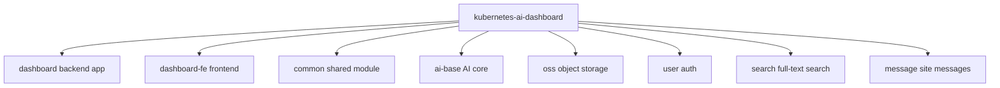

<div align="center">
  <h1>Kubernetes AI Dashboard</h1>
  <p><b>K8s Cluster Management + AI Assistant Platform</b></p>
  
  
  
  
  
</div>

<p align="center">
  🇺🇸 <a href="./README.md">English</a> | 🇨🇳 <a href="./README.zh-CN.md">简体中文</a>
</p>

## Table of Contents

- [Introduction](#introduction)
- [Features](#features)
- [Tech Stack](#tech-stack)
- [Project Structure](#project-structure)
- [Quick Start](#quick-start)
- [Configuration](#configuration)
- [API Reference](#api-reference)
- [Deployment](#deployment)
- [Contributing](#contributing)
- [License](#license)

## Introduction

Kubernetes AI Dashboard is an operations-oriented Kubernetes management platform with an integrated AI assistant. Built on the Fabric8 Kubernetes Client for full-resource cluster operations, Spring AI for tool-calling and chat, and a built-in A2A (Agent-to-Agent) protocol framework.

> [!NOTE]
> Designed for ops scenarios — unified K8s cluster resource management with AI-assisted operations.

## Features

- ☸️ **Full K8s Resource Management** — CRUD for Namespace / Pod / Deployment / StatefulSet / DaemonSet / Service / Ingress / PVC / PersistentVolume / StorageClass / ConfigMap / Secret / Event / Job / CRD
- ⚙️ **Ops-Focused K8s Views** — Node management (read-only), HPA autoscaling (view + min/max tuning), NetworkPolicy, RBAC (ServiceAccount / Role / ClusterRole / RoleBinding / ClusterRoleBinding), ResourceQuota (with usage-vs-limit view and CRUD)
- 🌍 **Multi-Cluster Management** — upload multiple kubeconfigs via the UI (persisted in MySQL), activate one cluster at a time, hot-switch without app restart
- 📊 **Cluster Overview** — node health and resource usage statistics
- 📁 **Object Storage Browser** — MinIO buckets, folder navigation, drag-and-drop upload, image/text preview
- 🐳 **Image Registry Browser** — Docker Registry v2 catalog, tags, manifest detail, image path copy
- 🔒 **Resource Ownership Tracking** — platform-created resources are labeled and audited per user; users can only delete what they created
- 🤖 **AI Chat** — Spring AI integration with tool-calling, streaming responses, and JDBC-backed conversation memory
- 🔌 **MCP Toolchain** — 7 built-in MCP tool services (K8s / System Info / Command Line / File / SSH / OSS / Docker Registry)
- 🤝 **A2A Protocol Framework** — Agent-to-Agent JSON-RPC 2.0 endpoint with a reserved `SolverProvider` extension point
- 🔐 **Auth** — Sa-Token, 32-char random token, Redis-backed sessions; zh-CN/en-US UI language switching

## Tech Stack

| Category | Technology | Version |
|----------|------------|---------|
| Language | Java | 21 |
| Framework | Spring Boot | 3.5.8 |
| AI Framework | Spring AI | 1.1.6 |
| K8s Client | Fabric8 Kubernetes Client | 7.3.1 |
| ORM | MyBatis Plus | 3.5.14 |
| Auth | Sa-Token | 1.44.0 |
| Object Storage | MinIO | 8.6.0 |
| Database | MySQL | 8.0+ |
| Cache | Redis | 7.0+ |
| Frontend Framework | Vue | 3.5 |
| Frontend Build | Vite | 8 |
| UI Components | Element Plus | 2.13 |

## Project Structure



```
kubernetes-ai-dashboard/
├── dashboard/              # Backend main app (cc.shiyi.dashboard)
├── dashboard-fe/           # Frontend app (Vue 3)
├── common/                 # Shared module (AOP annotations, utils)
├── ai-base/                # AI core (ChatClient pool, chat memory)
├── oss/                    # Object storage (MinIO)
├── user/                   # Auth (Sa-Token)
├── search/                 # Full-text search (Lucene)
├── message/                # Site messages
└── pom.xml
```

## Quick Start

### Prerequisites

- JDK 21+
- Maven 3.9+
- Node.js 18+
- Docker & Docker Compose
- Kubernetes cluster v1.24+

### Start Dependencies

```bash
cd docker
docker-compose up -d mysql redis minio
```

### Backend

```bash
mvn clean install -DskipTests
cd dashboard
mvn spring-boot:run
```

Backend runs at http://localhost:8080

### Frontend

```bash
cd dashboard-fe
npm install
npm run dev
```

Frontend runs at http://localhost:3000

## Configuration

Config file: `dashboard/src/main/resources/application.yml`. All values support `${ENV_VAR:default}` overrides.

| Env Var | Description | Default |
|---------|-------------|---------|
| `SPRING_DATASOURCE_URL` | MySQL JDBC URL | jdbc:mysql://127.0.0.1:3306/dashboard |
| `SPRING_DATA_REDIS_HOST` | Redis host | localhost |
| `MINIO_ENDPOINT` | MinIO URL | http://localhost:9000 |
| `SPRING_AI_OPENAI_BASE_URL` | AI API URL | - |
| `SPRING_AI_OPENAI_API_KEY` | AI API Key | `<YOUR_API_KEY>` |
| `KUBERNETES_CLIENT_TRUST_CERTS` | Trust K8s API certs | true |
| `DOCKER_REGISTRY_URL` | Docker Registry v2 address | - |
| `DOCKER_REGISTRY_USERNAME` | Docker Registry username | - |
| `DOCKER_REGISTRY_PASSWORD` | Docker Registry password | - |
| `A2A_API_KEY` | A2A protocol API Key | `<YOUR_API_KEY>` |

> [!IMPORTANT]
> There is **no kubeconfig entry point in config files**. Upload kubeconfigs on the **Cluster Config** page of the web UI — they are stored in MySQL, several clusters may coexist, but exactly one is active and all K8s operations target the active cluster. Switching clusters takes effect immediately (no restart).

## API Reference

### Internal API (`/api/v1/*`, Sa-Token login required)

| Method | Path | Description |
|--------|------|-------------|
| POST | `/api/v1/ai/chat` | AI chat (streaming/non-streaming) |
| GET/POST/PUT/DELETE | `/api/v1/k8s/*` | K8s resource management (namespaced + cluster-scoped) |
| POST/GET/DELETE | `/api/v1/k8s/cluster-config*` | kubeconfig upload / list / activate / delete / test |
| GET | `/api/v1/k8s/cluster/stats` | Cluster statistics |
| GET | `/api/v1/resources/ownership` | Resource ownership query |
| GET | `/api/v1/oss/*` | Object storage (buckets / files / folders) |
| GET | `/api/v1/registry/*` | Image registry (repositories / tags / manifests) |
| POST/GET | `/api/v1/user/*` | User management |

### A2A Protocol (`/a2a`, API Key auth)

| Method | Path | Description |
|--------|------|-------------|
| GET | `/a2a/card` | Get AgentCard |
| GET | `/.well-known/agent-card.json` | Standard discovery endpoint |
| POST | `/a2a` | JSON-RPC 2.0 (message/send, tasks/get, tasks/cancel) |

<details>
<summary>MCP Tools (7)</summary>

| Tool Service | Capability |
|--------------|------------|
| KubernetesMcpService | Namespace/Pod/Deployment ops, cluster stats |
| SystemInfoMcpService | CPU/memory/disk/uptime |
| CommandLineMcpService | Command execution (dangerous-command blacklist) |
| FileMcpService | File read/write (sandboxed) |
| SshMcpService | Remote SSH commands |
| OssMcpService | MinIO upload/list |
| DockerRegistryMcpService | Docker registry query |

</details>

## Deployment

For Docker deployment see [DOCKER_README.md](DOCKER_README.md).

```bash
# Build backend image
docker build -f dashboard/Dockerfile -t <REGISTRY>/kubernetes-ai-dashboard-backend:latest .

# Build frontend image
docker build -f dashboard-fe/Dockerfile -t <REGISTRY>/kubernetes-ai-dashboard-frontend:latest ./dashboard-fe
```

## Contributing

- [ ] Improve cluster monitoring alerts
- [ ] More K8s resource types

Issues and Pull Requests are welcome.

## License

This project uses an **Internal License** and is not open-sourced.
