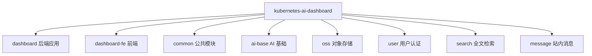

<div align="center">
  <h1>Kubernetes AI Dashboard</h1>
  <p><b>K8s 集群管理 + AI 智能助手平台</b></p>
  
  
  
  
  
</div>

<p align="center">
  🇨🇳 <a href="./README.zh-CN.md">简体中文</a> | 🇺🇸 <a href="./README.md">English</a>
</p>

## 目录

- [简介](#简介)
- [功能特性](#功能特性)
- [技术栈](#技术栈)
- [项目结构](#项目结构)
- [快速开始](#快速开始)
- [配置](#配置)
- [API 参考](#api-参考)
- [部署](#部署)
- [贡献](#贡献)
- [许可证](#许可证)

## 简介

Kubernetes AI Dashboard 是一个面向**运维人员**的 Kubernetes 管理平台，集成 AI 智能助手与 MCP 工具链。基于 Fabric8 Kubernetes Client 管理集群全量资源，通过 Spring AI 提供工具调用与智能对话，并内置 A2A（Agent-to-Agent）协议框架。

> [!NOTE]
> 本平台面向运维场景，提供 K8s 集群资源的统一管理界面与 AI 辅助运维能力。

## 功能特性

- ☸️ **K8s 全量资源管理**：Namespace / Pod / Deployment / StatefulSet / DaemonSet / Service / Ingress / PVC / PersistentVolume / StorageClass / ConfigMap / Secret / Event / Job / CRD 的增删改查
- ⚙️ **运维向 K8s 视图**：Node 节点管理（只读）、HPA 自动扩缩容（查看+min/max 调整）、NetworkPolicy、RBAC（ServiceAccount / Role / ClusterRole / RoleBinding / ClusterRoleBinding）、ResourceQuota（已用/上限对比 + 全 CRUD）
- 🌍 **多集群管理**：页面直接上传多个 kubeconfig（存 MySQL），同时只激活一个集群，切换即时生效（无需重启）
- 📊 **集群监控**：节点状态与资源使用统计
- 📁 **对象存储浏览器**：MinIO Bucket、目录导航、拖拽上传、图片/文本预览
- 🐳 **镜像仓库浏览器**：Docker Registry v2 仓库目录 / 标签 / Manifest 详情 / 镜像路径复制
- 🔒 **资源归属追踪**：平台创建的资源按用户归属记录并打标签审计，用户只能删除自己创建的资源
- 🤖 **AI 智能对话**：Spring AI 集成，支持工具调用与流式响应，JDBC 持久化对话记忆
- 🔌 **MCP 工具链**：内置 7 个 MCP 工具服务（K8s / 系统信息 / 命令行 / 文件 / SSH / OSS / Docker 注册表）
- 🤝 **A2A 协议框架**：Agent-to-Agent JSON-RPC 2.0 端点，预留 SolverProvider 扩展点
- 🔐 **认证授权**：Sa-Token，32 字符随机 Token，Redis 会话；zh-CN / en-US 界面语言切换

## 技术栈

| 类别 | 技术 | 版本 |
|------|------|------|
| 语言 | Java | 21 |
| 框架 | Spring Boot | 3.5.8 |
| AI 框架 | Spring AI | 1.1.6 |
| K8s 客户端 | Fabric8 Kubernetes Client | 7.3.1 |
| ORM | MyBatis Plus | 3.5.14 |
| 认证 | Sa-Token | 1.44.0 |
| 对象存储 | MinIO | 8.6.0 |
| 数据库 | MySQL | 8.0+ |
| 缓存 | Redis | 7.0+ |
| 前端框架 | Vue | 3.5 |
| 前端构建 | Vite | 8 |
| UI 组件 | Element Plus | 2.13 |

## 项目结构



```
kubernetes-ai-dashboard/
├── dashboard/              # 后端主应用（cc.shiyi.dashboard）
├── dashboard-fe/           # 前端应用（Vue 3）
├── common/                 # 公共模块（AOP 注解、工具类）
├── ai-base/                # AI 基础（ChatClient 池、聊天记忆）
├── oss/                    # 对象存储（MinIO）
├── user/                   # 用户认证（Sa-Token）
├── search/                 # 全文检索（Lucene）
├── message/                # 站内消息
└── pom.xml
```

## 快速开始

### 环境要求

- JDK 21+
- Maven 3.9+
- Node.js 18+
- Docker & Docker Compose
- Kubernetes 集群 v1.24+

### 启动依赖服务

```bash
cd docker
docker-compose up -d mysql redis minio
```

### 后端编译运行

```bash
mvn clean install -DskipTests
cd dashboard
mvn spring-boot:run
```

后端启动于 http://localhost:8080

### 前端开发

```bash
cd dashboard-fe
npm install
npm run dev
```

前端启动于 http://localhost:3000

## 配置

配置文件 `dashboard/src/main/resources/application.yml`，所有值支持 `${ENV_VAR:default}` 环境变量覆盖。

| 环境变量 | 说明 | 默认值 |
|----------|------|--------|
| `SPRING_DATASOURCE_URL` | MySQL JDBC 地址 | jdbc:mysql://localhost:3306/mpi_dashboard |
| `SPRING_DATA_REDIS_HOST` | Redis 地址 | localhost |
| `MINIO_ENDPOINT` | MinIO 地址 | http://localhost:9000 |
| `SPRING_AI_OPENAI_BASE_URL` | AI API 地址 | https://api.deepseek.com |
| `SPRING_AI_OPENAI_API_KEY` | AI API Key | `<YOUR_API_KEY>` |
| `KUBERNETES_CLIENT_TRUST_CERTS` | 信任 K8s API 证书 | true |
| `DOCKER_REGISTRY_URL` | Docker Registry v2 地址 | - |
| `DOCKER_REGISTRY_USERNAME` | Docker Registry 用户名 | - |
| `DOCKER_REGISTRY_PASSWORD` | Docker Registry 密码 | - |
| `A2A_API_KEY` | A2A 协议 API Key | `<YOUR_API_KEY>` |

> [!IMPORTANT]
> kubeconfig **不再从配置文件读取**。请在页面的「集群配置」上传 kubeconfig —— 存入 MySQL，可共存多个集群，但同时只激活一个，所有 K8s 操作均针对当前激活集群执行。切换集群即时生效（无需重启）。

## API 参考

### 内部管理 API（`/api/v1/*`，需 Sa-Token 登录）

| 方法 | 路径 | 说明 |
|------|------|------|
| POST | `/api/v1/ai/chat` | AI 对话（流式/非流式） |
| GET/POST/PUT/DELETE | `/api/v1/k8s/*` | K8s 资源管理（命名空间级 + 集群级） |
| POST/GET/DELETE | `/api/v1/k8s/cluster-config*` | kubeconfig 上传 / 列表 / 激活 / 删除 / 连接测试 |
| GET | `/api/v1/k8s/cluster/stats` | 集群统计 |
| GET | `/api/v1/resources/ownership` | 资源归属查询 |
| GET | `/api/v1/oss/*` | 对象存储（Bucket / 文件 / 文件夹） |
| GET | `/api/v1/registry/*` | 镜像仓库（仓库 / 标签 / Manifest） |
| POST/GET | `/api/v1/user/*` | 用户管理 |

### A2A 协议（`/a2a`，API Key 认证）

| 方法 | 路径 | 说明 |
|------|------|------|
| GET | `/a2a/card` | 获取 AgentCard |
| GET | `/.well-known/agent-card.json` | 标准发现端点 |
| POST | `/a2a` | JSON-RPC 2.0（message/send、tasks/get、tasks/cancel） |

<details>
<summary>MCP 工具列表（7 个）</summary>

| 工具服务 | 能力 |
|----------|------|
| KubernetesMcpService | 命名空间/Pod/Deployment 等资源操作、集群统计 |
| SystemInfoMcpService | CPU/内存/磁盘/运行时间 |
| CommandLineMcpService | 命令执行（危险命令黑名单） |
| FileMcpService | 文件读写（沙箱限制） |
| SshMcpService | 远程 SSH 命令 |
| OssMcpService | MinIO 上传/列表 |
| DockerRegistryMcpService | Docker 镜像仓库查询 |

</details>

## 部署

Docker 部署详见 [DOCKER_README.md](DOCKER_README.md)。

```bash
# 构建后端镜像
docker build -f dashboard/Dockerfile -t <REGISTRY>/mpi-dashboard-backend:latest .

# 构建前端镜像
docker build -f dashboard-fe/Dockerfile -t <REGISTRY>/mpi-dashboard-frontend:latest ./dashboard-fe
```

## 贡献

- [ ] 完善集群监控告警
- [ ] 增加更多 K8s 资源类型支持

欢迎提 Issue 与 Pull Request。

## 许可证

本项目采用**内部许可证**（Internal License），未公开开源。
